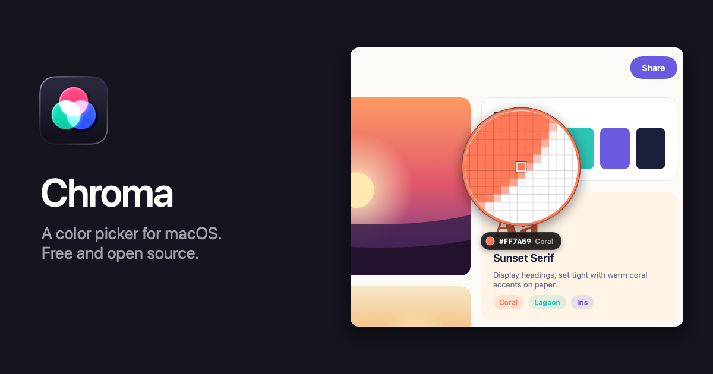

# Chroma

A free, open source color picker for macOS. Press **⌃⌥⌘P**, click any pixel on screen, and paste it as hex, CSS, SwiftUI, Tailwind, Compose or 30 other formats. Keep palettes, check contrast, and preview colors for color blindness. Inspired by [Sip](https://sipapp.io).

**[Download Chroma](https://github.com/nearbycoder/chroma/releases/latest/download/Chroma.dmg)** · [Website](https://nearbycoder.github.io/chroma/) · [Try the loupe in your browser](https://nearbycoder.github.io/chroma/#try) · requires macOS 26 Tahoe or later · signed with a Developer ID and notarized by Apple

## Features

- **A loupe that's exact.** The screen freezes and a magnifier follows the pointer, with the value and the color's name below it. Arrow keys move one pixel, scrolling zooms, and you can average a 3×3 or 5×5 square. ⇧-click to pick several colors in a row.
- **35 formats, plus your own.** Hex, CSS `rgb()`, `hsl()`, `oklch()` and `color(display-p3)`, the nearest Tailwind swatch, SwiftUI, UIColor, NSColor, CGColor, Objective-C, Jetpack Compose, Flutter, Android XML, React Native, Java, .NET, Unity, OpenGL, CMYK and more. Write custom formats with tokens like `{r}`, `{hex}` and `{name}`.
- **Smart formats.** Picks made in Xcode copy SwiftUI and picks in Android Studio copy Compose. Add a rule for any app. Tab cycles formats while picking.
- **History and palettes.** Every pick is saved. Drag colors into palettes, name them, add notes, sort by hue, lightness or name, merge, duplicate and lock palettes. Filter by name or hex, select with the arrow keys (⇧ to extend, ⌘A for all), copy with Return, and undo any change with ⌘Z.
- **Color Dock.** Your palettes in a glass strip at any screen edge. Click to copy, drag into any app, drop it in the middle of the screen to hide it.
- **Contrast checker.** WCAG 2 ratios for normal text, large text and UI, plus APCA (Lc). Fix buttons find the nearest passing text or background color while keeping the hue.
- **Color blindness preview.** Protanopia, deuteranopia, tritanopia and achromatopsia, for whole palettes and in the contrast checker.
- **Editor, harmonies and scales.** Edit in RGB, HSB, HSL or OKLCH; get complementary, analogous, triadic, split complementary and tetradic colors; turn any color into a 50–950 scale.
- **Import and export.** Reads Adobe Swatch Exchange (.ase), Apple Color Lists (.clr), GIMP palettes (.gpl), Sketch palettes, JSON, and any text with color codes in it. Writes those plus CSS variables, SCSS, a Tailwind v4 `@theme`, a SwiftUI extension, Android `colors.xml` and a PNG swatch sheet.
- **Sync through a folder.** The library is one readable `Library.json`. Put it in iCloud Drive or Dropbox and Chroma reloads it when another Mac changes it.
- **Automation.** Shortcuts actions (Pick Color, Get Last Picked Color, Convert Color, Add Color to Palette) and a URL scheme: `chroma://pick`, `chroma://contrast?text=%23333&background=%23fff`, `chroma://library?color=%23ff7a59`, `chroma://add?color=%23ff7a59&palette=Brand`, `chroma://dock`.

Chroma takes one still image of each display when you start picking and discards it when you finish. It has no network access, analytics or account.

## Shortcuts

| Key | Action |
| --- | --- |
| ⌃⌥⌘P | Pick a color (customizable) |
| ⌃⌥⌘O | Contrast checker |
| ⌃⌥⌘C | Library |
| ⌃⌥⌘D | Show or hide the Color Dock |
| Click / Return | Pick and copy |
| ⇧ Click | Pick and keep picking |
| Arrow keys | Move 1 px (⇧ for 10) |
| Scroll, ⌥+ / ⌥− | Magnification |
| + / − | Loupe size |
| Tab | Next format |
| G / S | Pixel grid / sample size |
| Esc | Cancel |

## Building

```sh
brew install xcodegen
xcodegen generate
open Chroma.xcodeproj
```

Run the tests with `xcodebuild test -project Chroma.xcodeproj -scheme Chroma -destination 'platform=macOS'`.

`./Scripts/release.sh` archives, signs with Developer ID, notarizes and packages a DMG; `./Scripts/release.sh publish` also tags the version and creates a GitHub release. Bump the version in `Resources/Info.plist` first.

Debug builds can drive the picker and open windows from a script for screenshots, without covering your screen: `./Scripts/shoot.sh <backdrop.png> <out.png> "move 900 400; zoom 15"`, or `./Scripts/shoot.sh - <out.png> window:library`. `./Scripts/make-site-assets.sh` regenerates every image on the website that way.

## Credits

Color names come from [Name That Color](https://chir.ag/projects/name-that-color/) by Chirag Mehta (CC BY 2.5). Tailwind swatches are the default palette of [Tailwind CSS](https://tailwindcss.com) v4 (MIT). Color blindness simulation uses the matrices from Machado, Oliveira and Fernandes (2009).

## License

[MIT](LICENSE) © 2026 Josh Hamilton. Sip is a trademark of its owners; Chroma is an independent project.
